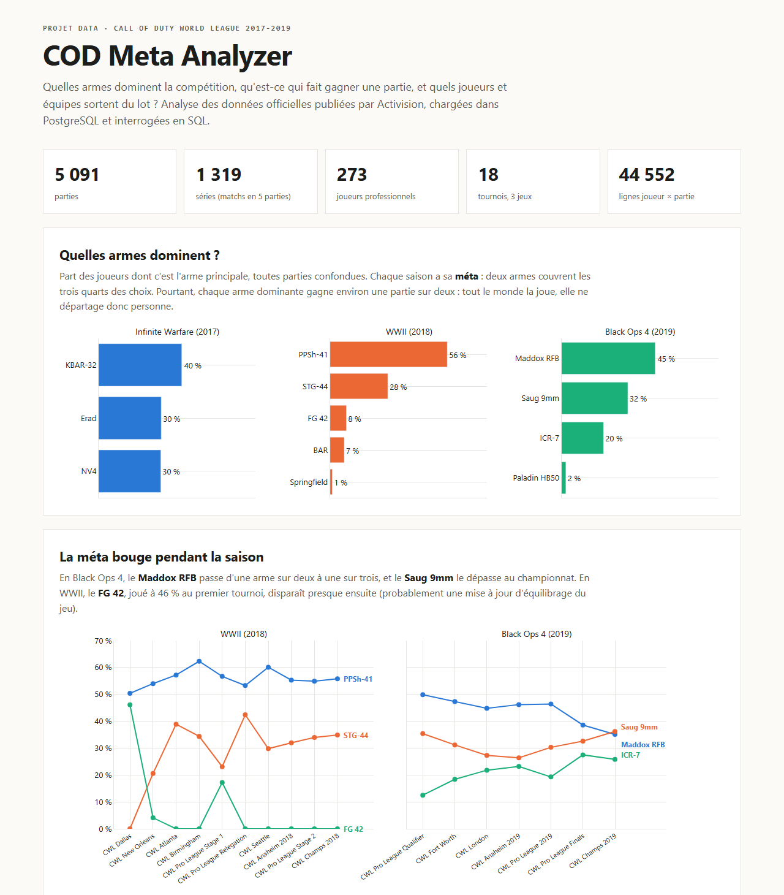
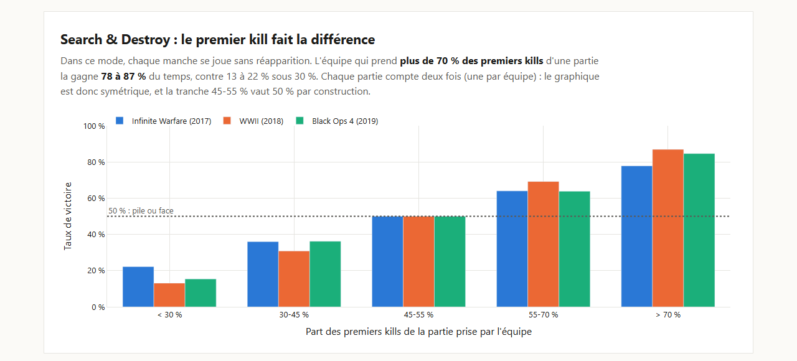

# COD Meta Analyzer

Analyse des **données officielles de la Call of Duty World League (2017-2019)** : quelles armes
dominent la compétition, qu'est-ce qui fait gagner une partie, quels joueurs et quelles équipes
sortent du lot. Données chargées dans **PostgreSQL**, nettoyées et modélisées en **SQL**,
restituées dans un **tableau de bord HTML interactif** généré en **Python**.

**Tableau de bord :** [`docs/index.html`](docs/index.html) (à ouvrir dans un navigateur)



## Ce que montrent les données

- **Chaque saison a sa méta** : deux armes couvrent les trois quarts des choix (PPSh-41 et STG-44
  en WWII, Maddox RFB et Saug 9mm en Black Ops 4).
- **La méta n'est pas un avantage en soi** : chaque arme dominante gagne environ une partie sur deux.
  Tout le monde la joue, elle ne départage donc personne.
- **La méta évolue pendant la saison** : en Black Ops 4, le Maddox RFB passe d'une arme sur deux à une
  sur trois, et le Saug 9mm le dépasse au championnat.
- **Search & Destroy** : l'équipe qui prend plus de 70 % des premiers kills d'une partie la gagne
  78 à 87 % du temps.
- **Les meilleures équipes** : 100 Thieves (79 % de séries gagnées) et eUnited (76 %) en Black Ops 4,
  Rise Nation (72 %) en WWII.



## Les données

| | |
|---|---|
| Source | Publication officielle d'Activision (« Call of Duty World League data release »), licence BSD 3-Clause |
| Contenu | 1 ligne par joueur et par partie, captée en direct sur les consoles des tournois, nettoyée et validée par Activision |
| Volume | 18 tournois, 3 jeux (Infinite Warfare, WWII, Black Ops 4), 5 091 parties, 1 319 séries, 273 joueurs, 44 552 lignes |
| Accès | Le dépôt d'origine `Activision/cwl-data` n'est plus en ligne ; les fichiers sont lus dans une copie conforme (fork) figée au dernier commit de l'auteur de la publication (28 août 2019). Empreintes SHA-256 enregistrées dans `data/raw/source.json`. |

## Architecture

```
18 CSV officiels (Activision, 2017-2019)
        │  pipeline/extract.py : téléchargement + empreintes
        ▼
PostgreSQL ── raw.player_game        les CSV tels quels, tout en texte (86 colonnes)
        │   sql/01_staging.sql       typage, nettoyage, résultats des parties (schéma stg)
        │   sql/02_modele.sql        modèle en étoile (schéma core)
        │   sql/03_kpi.sql           indicateurs et analyses (schéma kpi)
        │   sql/09_controles.sql     10 contrôles qualité : le build échoue si un seul est faux
        ▼
pipeline/dashboard.py  →  docs/index.html  (Plotly, un seul fichier)
```

**Modèle :** trois tables de faits à trois grains (joueur × partie, équipe × partie, série) et quatre
dimensions (tournoi, carte, équipe, joueur).

## Démarrage

Prérequis : [uv](https://docs.astral.sh/uv/) et PostgreSQL (≥ 14). Par défaut, le pipeline utilise un
PostgreSQL portable situé dans `~/.local/pgsql` et crée sa base dans `.postgres/` (port 5433) ; pour un
autre serveur, définir `DATABASE_URL`.

```bash
uv sync                                    # installe l'environnement Python
uv run python -m pipeline.extract          # télécharge les 18 CSV officiels
uv run python -m pipeline.db init          # crée la base PostgreSQL locale (une seule fois)
uv run python -m pipeline.db load          # charge les CSV dans le schéma raw
uv run python -m pipeline.db build         # nettoyage, modèle, indicateurs, contrôles
uv run python -m pipeline.dashboard        # génère docs/index.html
```

Explorer avec un fichier SQL quelconque :

```bash
uv run python -m pipeline.db run sql/exploration/03_kpi.sql
```

## Le projet, étape par étape

1. [Exploration des données brutes](etapes/01-exploration.md)
2. [Nettoyage, modèle et contrôles](etapes/02-modele.md)
3. [Indicateurs et analyses de la méta](etapes/03-kpi.md)
4. [Tableau de bord](etapes/04-tableau-de-bord.md)

## Limites

- **Données manquantes** documentées par Activision : environ 80 parties perdues à Birmingham 2018,
  317 parties sur environ 400 au qualificatif Pro League 2019. 44 séries incomplètes sont exclues des
  classements d'équipes.
- **Infinite Warfare** ne compte qu'un tournoi (le championnat 2017) : pas d'évolution de la méta
  possible, seuil de classement des joueurs abaissé à 25 parties.
- **Corrélation n'est pas causalité** : l'équipe qui fait plus d'éliminations gagne souvent, mais gagner
  fait aussi faire plus d'éliminations. En Hardpoint, le score *est* le temps passé dans la zone.
- L'« arme préférée » est l'arme principale la plus utilisée par le joueur dans la partie, pas la seule.
